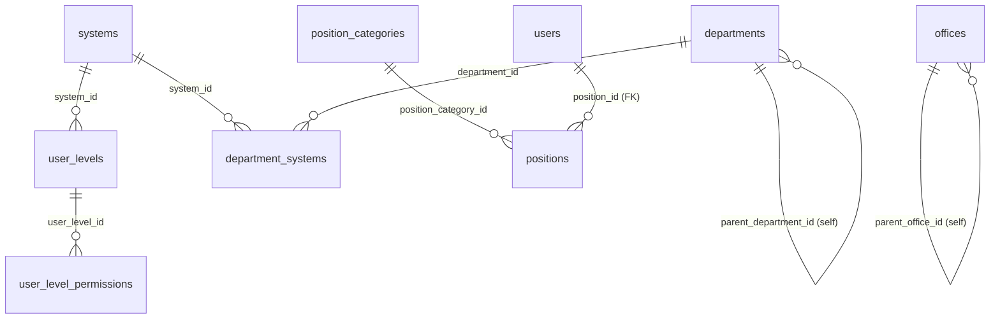
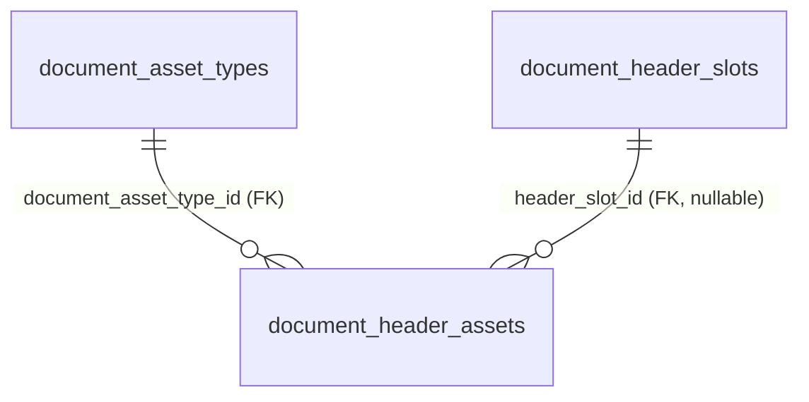
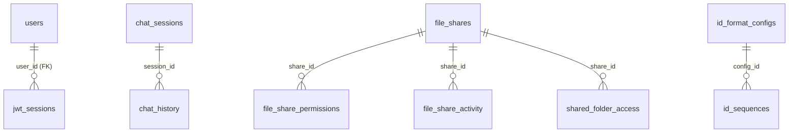
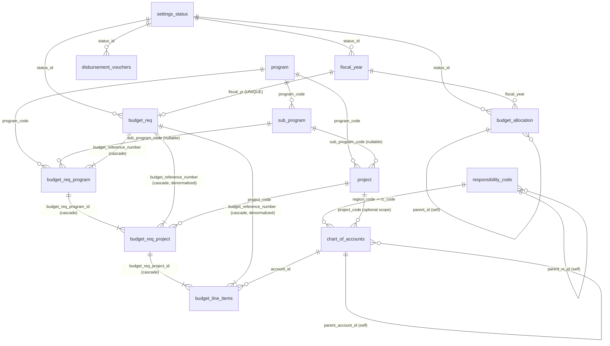
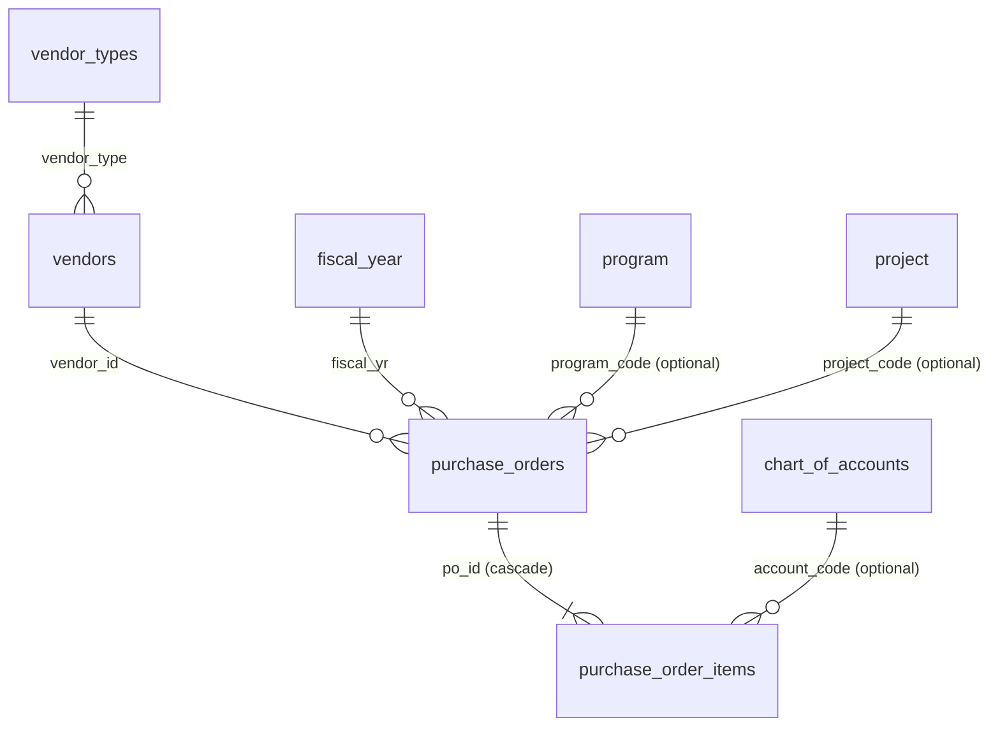
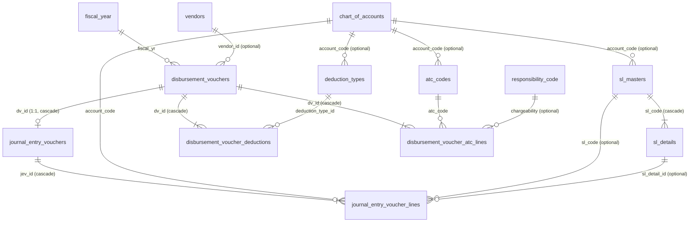
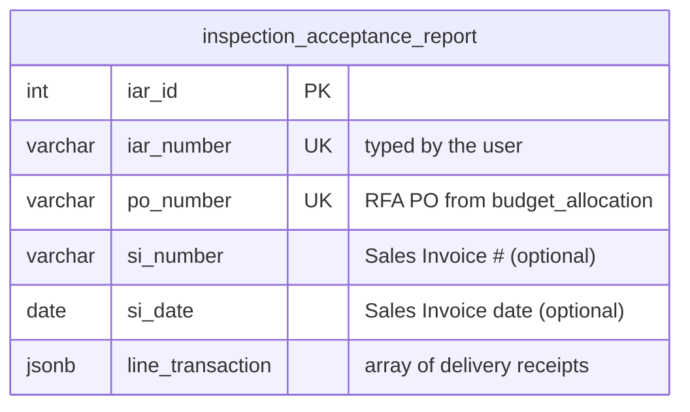
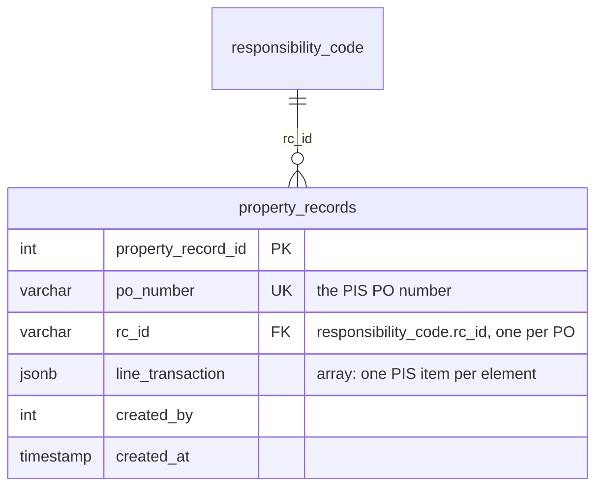

# Entity-Relationship Diagrams — FIMS NHA

> **Status:** rewritten 2026-11-09 against the actual schema in `_assets/sql/` and a verified
> dry-run install; §2.3 (Disbursement Vouchers & Journal Entries) added 2026-11-10 once that module
> grew Deductions, multi-row ATC, and Subsidiary Ledger support; §2.4 (Inspection and Acceptance
> Report — IAR) added 2026-11-10. The previous version of this file
> described a 9-schema, 371-file predecessor architecture (`shared`, `accounting`, `treasury`,
> `regional`, `district`, `integration`, an `ACCOUNTING-BAPD/sql/` tree, `npm run …` wrappers) that
> predates this repo's 2026-11-06 rebuild — none of that exists here. See
> `system_docs/developerguide/DEVELOPER-GUIDE.md` §11 for the full list of docs still carrying that
> old architecture, and `_assets/sql/README.md` for the SQL folder / installer mechanics (not
> duplicated here).

## Scope

Only **two schemas have tables in them today**: `uac` and `fims`. `schema.sql` also creates `fmd`
and `workflow`, but nothing is ever created inside them — leftovers from the predecessor project's
schema plan (see `_assets/sql/README.md` → Database Schemas).

| Schema | Tables (verified live, 2026-11-10) | Covered below |
|---|---|---|
| `uac` | 30 | §1 |
| `fims` | 31 (29 verified live + `inspection_acceptance_report` from §2.4 and `property_records` from §2.5, installed and exercised locally) | §2 |
| `fmd` | 0 (schema exists, empty) | — |
| `workflow` | 0 (schema exists, empty) | — |

## How to read these diagrams

Every relationship drawn below (`||--o{`, `||--|{`, `||--o|`) is backed by an actual
`FOREIGN KEY` / `REFERENCES` constraint in the SQL — **not** just a same-named column.

This distinction matters a lot in `uac`: most of its tables were generated by PHPMaker from the
predecessor project's conventions, and outside of four constraints (see §1), every other
`*_id` column that *looks* like a foreign key (`users.department_id`, `departments.office_id`,
`user_level_assignments.user_id`, `plantilla_items.position_id`, …) is a **plain, unenforced
integer** — no constraint exists in the database. Nothing stops an orphaned value. Those links are
called out in prose under each table, not drawn, so the diagrams don't claim integrity guarantees
the schema doesn't actually have. `fims`, built fresh for this rebuild, is the opposite: almost
every relationship is a real, enforced FK — the few exceptions are called out explicitly in §3.

---

## 1. `uac` schema — User Access Control & platform

### 1.1 Identity, organization & permissions



Only `users.position_id -> positions.position_id` is an enforced FK (added in
`02 - alter_table/03 - users_add_position_employee_mustchange.sql`). Everything else in this group
is a conventionally-named, **unenforced** link:

| Table | Purpose | Unenforced links (no DB constraint) |
|---|---|---|
| `systems` | Registry of subsystems (FIMS, …) a user level can be scoped to | — |
| `user_levels` | Named permission levels (e.g. "Department Manager"), optionally scoped to a `system_id` | `system_id` → `systems` |
| `user_level_permissions` | Bitmask (1=View, 2=Add, 4=Edit, 8=Delete) per `(user_level_id, table_name)` | `user_level_id` → `user_levels` |
| `user_level_assignments` | Which user has which level, per system | `user_id` → `users`, `user_level_id` → `user_levels`, `system_id` → `systems` |
| `users` | Login + identity. `user_level_id` is a **comma-separated VARCHAR** (PHPMaker convention), not an FK at all | `department_id` → `departments`, `reports_to_user_id` → `users` (self) |
| `departments` | Org hierarchy; `department_type`/`hierarchy_level` flag org level; `is_budget_unit` flags budget-holding units | `parent_department_id` (self), `office_id` → `offices`, `rc_id` → *intended* `fims.responsibility_code` (see gap in §3) |
| `department_systems` | Which department can access which system, with an `access_level` | `department_id` → `departments`, `system_id` → `systems` |
| `offices` | Physical NHA office locations | `parent_office_id` (self), `rc_id` → *intended* `fims.responsibility_code` (same gap) |
| `user_offices` | A user's office assignments (multi-office support), one flagged `is_primary` | `user_id` → `users`, `office_id` → `offices` |
| `position_categories` | Classification of positions (First/Second/Third Level, Elective, …) | — |
| `positions` | Position **templates** (e.g. "Administrative Assistant III") reusable across departments | `position_category_id` → `position_categories` |
| `plantilla_items` | Authorized staffing slots per department+position, with budget allocation fields | `department_id` → `departments`, `position_id` → `positions` |
| `permission_module_captions` | Admin-editable display caption / hide-flag for a module row in the Permissions Management UI — does not touch `user_level_permissions` itself | — |

### 1.2 Document branding (letterhead/footer composer)



Both relationships here **are** enforced FKs.

| Table | Purpose |
|---|---|
| `document_asset_types` | Kinds of branding asset (`HEADER`, `FOOTER`) and the px size each renders at |
| `document_header_slots` | The 4 managed parts of the NHA letterhead — `LOGO`, `TITLE` (text), `BRAND`, `SEAL` — their left-to-right order and default column width % |
| `document_header_assets` | Uploaded image (or, for `TITLE`, plain text) per slot/scope. `scope_system_code`/`scope_document_code` narrow an asset to one system or document type; `header_slot_id IS NULL` means a legacy whole-header image. A partial unique index enforces **one active asset per `(type, slot, scope)`** |

### 1.3 Collaboration & platform utilities



Only `jwt_sessions.user_id -> users.user_id` is enforced. The rest (`chat_history.session_id`,
every `file_share*.share_id`/`user_id`, `id_sequences.config_id`) are unenforced integer links.

| Table | Purpose |
|---|---|
| `jwt_sessions` | Server-side registry of every JWT issued (LIBIS login today) — enables revocation and tamper/discrepancy detection against the token's own claims |
| `chat_sessions` / `chat_history` | AI-assistant chat sessions and their messages, per user |
| `file_shares` / `file_share_permissions` / `file_share_activity` / `shared_folder_access` | S3-backed file sharing: the share itself, per-user permission level, an audit trail, and a "favorites" list |
| `id_format_configs` / `id_sequences` / `id_reset_strategies` | Configurable document-numbering formats (e.g. `PR-FY2025-0001`) and the running counters that back them |
| `notifications` / `notification_reads` | Notification hub (migration `06 - notifications_hub.sql`). `notifications` holds one row per message addressed by `type` (`all`/`system`/`user`/`userlevel`/`office`/`usergroup`) + `target`, with `sender_id` and a unique-when-set `event_key` for de-duping; `notification_reads` records which user has read which notification. Targets are unenforced links, like the other uac tables. See the developer guide §8.6. The table was originally marked "STRICT – DO NOT MODIFY" (PHPMaker-compatible) — the hub adds columns only |
| `audit_logs` | PHPMaker-compatible immutable audit trail (one row per changed field). **Also marked STRICT – DO NOT MODIFY.** `uac.aggregated_audit_logs` is a view that rolls these up one-row-per-save for the dashboard |
| `psgc` | Philippine Standard Geographic Code reference table (regions/provinces/cities) |

---

## 2. `fims` schema — Budgeting, Reference Data & Procurement

### 2.1 Budgeting & reference data



| Table | Purpose / notes |
|---|---|
| `settings_status` | Shared status lookup, scoped per entity via `status_for` (e.g. `'fiscal_year'`, `'budget_req'`). `next_actors` (JSONB; renamed from `actors`) names who acts next on a record that has reached that status |
| `fiscal_year` | One row per fiscal year; PK is the year itself (`SMALLINT`) |
| `program` / `sub_program` / `project` | Budget hierarchy. A project optionally narrows to a `sub_program_code`; a sub-program always belongs to one `program_code` |
| `budget_req` | **One header row per fiscal year** (`UNIQUE(fiscal_yr)`, enforced in `03 - alter_table/04`). Despite the name, it no longer carries an amount, program, or expense class directly — see gap note in §3. Carries `remarks` (nullable `TEXT`, `03 - alter_table/13`): the reason entered when the request was last Returned |
| `budget_req_program` | One Program (optionally + Sub-Program) line added to a `budget_req` header |
| `budget_req_project` | One Project line, nested under a `budget_req_program` row (and, redundantly, under the `budget_req` header directly — see denormalization note below) |
| `budget_line_items` | One chart-of-accounts allocation under a `budget_req_project` row. Carries `proposed_amount`, `suggested_amount`, and the execution-tracking amounts `adjustment` / `obligation` / `disbursement` / `account_payable` (all `NOT NULL DEFAULT 0`). `component_id` / `type_of_fund_id` are present but **have no FK** — see §3. The `program_source_code` / `program_uses` columns that `03 - alter_table/17` and `/18` added were dropped again by `03 - alter_table/22` |
| `budget_revision` | Revises a **budget line** (`budget_line_items` row): changes the From line's amount, or moves the difference to a To line (`to_budget_line_item_id IS NULL` = a plain revision of one line). `from_budget_line_item_id` / `to_budget_line_item_id` hold a `budget_line_items.budget_line_item_id` (`03 - alter_table/23`); `status_id` / `user_id` are plain integers; **none of them has an FK** — not drawn above. The earlier `from_budget_req_id` / `to_budget_req_id` (a budget *request's* id, which no longer exists) are left in place, unused. A line's current amount is `proposed_amount + adjustment`; approving a revision only moves `budget_line_items.adjustment` — the From line goes down, the To line goes up — and never `proposed_amount` |
| `chart_of_accounts` | COA tree (`parent_account_id` self-FK). Optionally scoped to a responsibility center (`region_code -> responsibility_code.rc_code`) and/or a `project_code` |
| `responsibility_code` | RCA (Responsibility Center/Accounting) tree (`parent_rc_id` self-FK). `is_budget_holding_rc` flags units that can hold a budget. `rc_id` is the PK and is `VARCHAR(10)` — see the `uac.departments`/`uac.offices` type-mismatch gap in §3 |
| `type_of_fund` / `component_type` | Small lookup tables (fund source; CO / Other-CO / COE) seeded with a handful of rows. Referenced by `budget_line_items.type_of_fund_id` / `.component_id` **by convention only — no FK exists yet** |
| `budget_allocation` | Memo/PR/PO allocation tracking per fiscal year + requesting RC (the creator's `uac.users.rc_id`) / district, with a `parent_id` self-FK for derived allocations. Built via `CREATE TABLE fims.budget_allocation(); ALTER TABLE ... ADD COLUMN` (see the file for why). `request_referrence_no` (VARCHAR(50) — the spelling is the column's real name) is **generated by the database**: its default is `fims.next_request_referrence_no()`, which takes the next value of a sequence and formats it `RR-001`, `RR-002`, … (it grows past 999, never truncates); unique, never reused (a failed insert leaves a gap). Added, with the existing rows numbered oldest-first, by `03 - alter_table/19`. Most of its columns (`requesting_rc_id` — VARCHAR(50), renamed from `requesting_department_id` in `03 - alter_table/14` — `requesting_district_id`, `program_id`, `sub_program_id`, `project_id`, `category_id`, `user_id`) are **deliberately left unconstrained** — see the comment in `03 - alter_table/08 - budget_allocation_add_fk.sql` for the reasoning per column |
| `ip_filemeta` | One uploaded file (or typed link / reference) of a Supporting Document: `document_name VARCHAR(225)`, `link TEXT` (the object-storage key, or the link), `created_by`, a unique `node_id` UUID (default `gen_random_uuid()`), `created_at` / `updated_at`, soft-delete `deleted_at`. Written by `FileUploadServices` (`01 - table/17`) |
| `file_attachments` | Groups files: one `multiple_node_id` UUID per upload batch, one row per file with that file's `ip_filemeta.node_id` as `file_node_id` (+ its own `node_id`, `created_by`, timestamps, `deleted_at`). The owning record stores the `multiple_node_id` (`budget_allocation.multiple_node_id`). No FKs, by convention (`01 - table/18`) |

**Denormalization, twice:** `budget_line_items` carries both `budget_req_project_id` (the real
parent) and `budget_reference_number` (the grandparent header), and `budget_req_project` carries
both `budget_req_program_id` (the real parent) and `budget_reference_number` (same grandparent).
Both are intentional — see the comments in `03 - alter_table/03` and `03 - alter_table/05` — so
existing header-level joins/counts keep working without walking the full chain. The service layer
keeps both columns in sync on write; nothing in the DB enforces that they agree.

### 2.2 Vendors & procurement

API: `app/routes/vendor.php`, `app/routes/purchase-order.php` (see `app/routes/README.md`).
Pages: `app/pages/po/{page,form,readone}.php`.



| Table | Purpose / notes |
|---|---|
| `vendor_types` | Valid vendor categories (`SUPPLIER`, `CONTRACTOR`, `CONSULTANT`, `SERVICE_PROVIDER`, `EMPLOYEE` — seeded). `vendor_type` is UNIQUE so `vendors` can FK to it by value |
| `vendors` | Suppliers/contractors/consultants. `vendor_code` is UNIQUE; `vendor_type` is a real FK (by value, not id) |
| `purchase_orders` | One PO. `po_number` UNIQUE (`PO-YYYY-MM-NNNN`). Vendor name/address/TIN are a **snapshot** copied from `vendors` on save, so later vendor edits don't rewrite history. `status`: `DRAFT → SUBMITTED → APPROVED / REJECTED`; `DRAFT`/`SUBMITTED`/`REJECTED` can be `CANCELLED`. `expense_class` here is a free-text column with its own `CHECK (... IN ('PS','MOOE','CAPITAL_OUTLAY','CO','OTHER'))` — **it is not the same vocabulary as, or linked to, `fims.expense_class`** (see §3) |
| `purchase_order_items` | Line items. `total_cost` is generated (`ROUND(quantity_ordered * unit_cost, 2)`); `(po_id, line_number)` is UNIQUE. `account_code` FKs to `chart_of_accounts.account_code` — the **only** FK in this schema that targets an alternate key instead of the primary key |

**Deliberately not ported** from the predecessor project's `fmd.purchase_orders`: parent purchase
request, budget allocation, fund source, fiscal period, workflow engine/payment workflow — none of
those tables exist in `fims`. (Delivery receipts do now exist, but as the separate, PO-number-keyed
IAR module in §2.4 — **not** linked to `purchase_orders`.) Status changes are driven entirely by
`PurchaseOrderService::changeStatus()`, not a workflow engine.

### 2.3 Disbursement Vouchers & Journal Entries

API: `app/routes/voucher.php` (see `app/routes/README.md`). Pages: `app/pages/voucher/{page,form,readone}.php`.
Service: `DisbursementVoucherService`. One generic voucher shape backs every claimant/payment type
(vendor payment, payroll, reimbursement, …) — the paper General Form No. 1 is itself one layout;
what differs is only what gets written into Particulars/Amount.



| Table | Purpose / notes |
|---|---|
| `disbursement_vouchers` | One DV header. Pipeline: `DRAFT → FOR_FMD_REVIEW → FOR_ACCOUNTING → FOR_TREASURY → RELEASED` (Originating → FMD checks the obligation → Accounting processes → Treasury releases), or `REJECTED` (notes required) / `CANCELLED` from any non-terminal stage — see `DisbursementVoucherService::TRANSITIONS`/`authorizeTransition()`. `status_id` FKs to `settings_status` (`status_for = 'disbursement_voucher'`, seeded in `02 - sample_data/01 - fims_settings_status.sql`) — same shared-lookup convention as `budget_req`/`budget_allocation`; resolved by name via `DisbursementVoucherService::getStatusIdByName()`, so the pipeline names above are unchanged, only their storage moved off a free-text column (`03 - alter_table/21`). `account_code` is **required**, must be `posting_allowed` — validated in PHP, not a DB FK (the Journal Entry's auto-filled Dr line, see `readone.php`'s `vje_syncAutoLines`, would otherwise be blank). `net_amount` is a **service-computed snapshot** (`gross_amount - total deductions - total withholding tax`), not a generated column — it started as one (`gross - vat - wtax`) but those columns were dropped once deductions/withholding became repeating tables (`03 - alter_table/17`). `budget_amount`/`obligation_amount`/`payments_prior_amount`/`balance_amount` are likewise snapshots, stamped at save time from the selected RFA and recomputed on every `create()`/`update()`/`saveJournalEntry()` call — see the denormalization note below |
| `journal_entry_vouchers` | The accounting entry Accounting prepares during `FOR_ACCOUNTING` (`jev_no` auto-numbered `JEV-{YY}-{MM}-{NNNN}`). **One per DV** (`dv_id` is `UNIQUE`) — this project doesn't model a separate obligation-setup JEV and payment JEV, just one combined entry. `total_debit`/`total_credit` are a snapshot of the lines, must be equal and >0 before `FOR_ACCOUNTING → FOR_TREASURY` is allowed (`changeStatus()`) |
| `journal_entry_voucher_lines` | Debit/credit lines (`UNIQUE(jev_id, line_number)`; exactly one of debit/credit nonzero — validated in PHP, not a CHECK constraint, same convention as `purchase_order_items`). `account_code` is a required FK to `chart_of_accounts` (`posting_allowed` enforced in PHP). `sl_code`/`sl_detail_id` are optional Subsidiary Ledger breakdown columns — not every line needs one |
| `sl_masters` / `sl_details` | Subsidiary Ledger registry, added for the Accounting Entries grid's SL Code/SL Detail columns — this project had **no SL infrastructure at all** before. An `sl_masters` row optionally ties to one `chart_of_accounts` control account (e.g. one Accounts Payable row per major vendor); `sl_details` further splits a master (e.g. by PO/contract) |
| `deduction_types` | Lookup of non-tax deductions a DV's gross can be reduced by (e.g. contractor retention — currently the only seeded row). `account_code` (optional) is the GL account the Accounting Entries grid auto-credits when this type is used — see the auto-fill note below |
| `disbursement_voucher_deductions` | Deduction line items, entered by **Originating** at DV creation/edit (`app/pages/voucher/form.php`), not by Accounting. `deduction_amount` is either `gross_amount * rate / 100` or typed directly when `rate IS NULL` — enforced in PHP |
| `atc_codes` | BIR Alphanumeric Tax Codes (withholding tax classifications). `account_code` (optional) is the liability account (e.g. Due to BIR) the Accounting Entries grid auto-credits |
| `disbursement_voucher_atc_lines` | Withholding tax lines, entered by **Accounting** alongside the Journal Entry (`saveJournalEntry()` saves both together) — replaces an earlier single `disbursement_vouchers.atc_code` column, since one DV can withhold under more than one ATC at once. `withholding_tax` (`tax_base * rate / 100`) is server-computed, never trusted from the client. `chargeability` optionally FKs to `responsibility_code` |

**Journal Entry auto-fill:** the Accounting Entries grid (`readone.php`'s `vje_syncAutoLines()`) generates a Dr line for the DV's own `account_code` (full `gross_amount`), a Cr line per Deduction/ATC row whose type/code has an `account_code` mapped, and a Cr Accounts Payable line for whatever's left — live-synced as Accounting adds/edits ATC rows, until the Journal Entry is saved once (saved lines are then respected as-is, even if more ATC rows are added later). This is why `deduction_types.account_code` / `atc_codes.account_code` exist — they're what makes the auto-fill possible, not just descriptive metadata.

**Snapshots, not live joins:** `budget_amount`/`obligation_amount`/`payments_prior_amount`/`balance_amount`/`net_amount` on `disbursement_vouchers` all reflect the state *as of that voucher's own last save* — same convention as `fims.purchase_orders`' snapshot vendor fields. Several DVs can draw against the same RFA over time (progress payments — see `payments_prior_amount` = sum of `net_amount` from every other active voucher on that RFA, computed at save time); an **earlier** voucher's own stored figures don't retroactively update when a **later** one is saved, matching how a signed paper DV isn't edited after the fact.

**Not enforced by a DB constraint** (validated in `DisbursementVoucherService`, not the schema): `disbursement_vouchers.rfa_allocation_id` (→ `fims.budget_allocation` — that table has no CRUD backend of its own yet) and `disbursement_vouchers.requesting_department_id`.

### 2.4 Inspection and Acceptance Report (IAR)

API: `app/routes/po_dr.php` (`/po-dr/*`). Service: `PoDrService`. Page: `app/pages/iar-module.php` +
`app/pages/form/dr-module-form.php` (PHPMaker page `IarModule`). SQL: `01 - table/25 - fims_inspection_acceptance_report.sql`.

**One table.** One PO number has **one IAR** row, and that row's `line_transaction` (JSONB array) holds the PO's
**delivery receipts (DR)**; each DR holds its account rows (account code, account title, amount) and, from a total of
50,000, the optional items (any number, one line each). The total of a DR may not exceed the PO balance.



`line_transaction` element (one per delivery receipt):

```json
{ "dr_number": "DR-001", "delivery_date": "2026-11-12", "total_amount": "800000.00",
  "lines": [ { "account_code": "1-06-05-030", "account_title": "Information and Communications Technology Equipment", "amount": "600000.00" },
             { "account_code": "5-02-03-990", "account_title": "Other Supplies and Materials Expenses", "amount": "200000.00" } ],
  "items": [ { "description": "...", "serial_no": "...", "amount": "600000.00", "property_no": "..." } ] }
```

| Table | Purpose / notes |
|---|---|
| `inspection_acceptance_report` | The IAR, one row per PO number. `iar_number` is **typed by the user** (required; `PoDrService` checks it isn't used by another PO) and can be edited later. `po_number` and `iar_number` are both `UNIQUE`. Holds the Sales Invoice # / date (entered once per PO). `line_transaction` is a JSONB array (`CHECK (jsonb_typeof(...) = 'array')`, GIN-indexed) of delivery receipts. `total_amount` of each DR is the sum of its line amounts (computed by the app) and is what counts toward the PO balance. `items` are stored only when the DR total is 50,000 or more. The `dr_number` (unique within the PO) and each item's `serial_no` (unique across all items of all DRs) are checked in PHP — JSONB array elements can't carry a DB unique key — so there are no `po_delivery_receipt` / entry tables and no FK; deleting the row deletes its DRs |

**Pro-forma JEV (not stored separately).** The "Pro-forma" action shows each delivery receipt's
account rows as debits plus one credit of the DR total to `2-01-01-010` Accounts Payable (account titles are the ones stored with the rows) in the accounting
grid (`PoDrService::proforma()`). The Subsidiary Ledger columns are not populated. The Create JEV button
is a placeholder — it does not write to `journal_entry_vouchers` yet.

### 2.5 Property Records

API: `app/routes/property_record.php` (`/property-record/*`). Service: `PropertyRecordService`. Page: `app/pages/property-record-page.php` (PHPMaker page `PropertyRecordPage`). SQL: `01 - table/34 - fims_property_records.sql`.
External source: the NHA Property Inventory System (PIS) API (`inventory_by_po`), searched by PO number — only a PO that already has an IAR can be searched, and only PAR items (PIS `TYPENO` 1) can be saved.



`line_transaction` element (the PIS fields that are kept, under the PIS's own names): `inv_id, TYPENO, GL, accnt_desc, GLCODE_SUB, inv_glcode_sub, PROPNO, SNO, ITEMDESC, MODELNO, DATEACQD, COST, UNIT, SERV, RCCODE, dept_proj_desc, PO_NO, DEPTCD, District`.
The PO date and the IAR number are not stored (they stay in the IAR module; the list joins the IAR by PO number). The register shown in the list (combined units, acquisition cost, depreciation) is computed when the page loads — nothing of it is stored.

---

## 3. Cross-schema links & known gaps

| From | To | Enforced? | Note |
|---|---|---|---|
| `uac.users.region_code` | `fims.responsibility_code.rc_code` | **Yes** (FK) | Scopes a user to one RCA code for Chart-of-Accounts row-level security; `NULL` = unrestricted. Superadmin (`user_level_id` containing `-1`) always bypasses it regardless |
| `uac.departments.rc_id` | `fims.responsibility_code.rc_id` | **No — can't be**: type mismatch | `departments.rc_id` is `int4`; `responsibility_code.rc_id` is `VARCHAR(10)`. The column exists ("Responsibility Center Code for financial tracking") but cannot physically FK to the table it's named after. Same issue on `uac.offices.rc_id` |
| `fims.expense_class` | *(nothing)* | — | Seeded with `CO`/`PS`/`MOOE`/`EO` but **no longer referenced by any FK** — `budget_req.expense_class_id` (its only consumer) was dropped in `03 - alter_table/02 - budget_req_remove_expense_class_flow.sql`. `purchase_orders.expense_class` is a separate, differently-valued free-text column, not a link to this table. Orphaned lookup table; confirm nothing reads it before dropping |
| `fims.budget_line_items.component_id` / `.type_of_fund_id` | `fims.component_type` / `fims.type_of_fund` | No | Named and seeded to match, but no FK constraint exists yet (see table comment in `03 - alter_table/06`) |
| `fims.budget_revision.from_budget_line_item_id` / `.to_budget_line_item_id` | `fims.budget_line_items.budget_line_item_id` | No | New in `03 - alter_table/23`; no FK, so nothing stops a dangling value — a Draft request's Program edit deletes and re-creates its lines — and a revision whose line is gone (or that was filed before budget lines were revised) still lists, with the line's details blank. The legacy `from_budget_req_id` / `to_budget_req_id` columns point at nothing |
| `fims.budget_allocation.{program,sub_program,project}_id` | `fims.{program,sub_program,project}` | No — can't be | Those tables are keyed by `*_code VARCHAR`, not an integer id; `budget_allocation` stores integers. Intentionally unconstrained per `03 - alter_table/08` |
| `fims.disbursement_vouchers.rfa_allocation_id` | `fims.budget_allocation.allocation_id` | No | `fims.budget_allocation` has no CRUD backend of its own yet (see §2.1); `DisbursementVoucherService::fetchRfaOptions()`/`fetchRfaDetail()` are a read-only lookup over it, no FK |
| `fims.disbursement_vouchers.requesting_department_id` | `uac.departments.department_id` | No | Snapshotted from the selected RFA at save time, same unconstrained convention as the RFA link itself |
| `fims.disbursement_vouchers.account_code` | `fims.chart_of_accounts.account_code` | No | Required and `posting_allowed`-checked in `DisbursementVoucherService::prepare()`, not a DB FK — mirrors `purchase_order_items.account_code`'s "FK targets an alternate key" exception in §2.2, except here there's no FK at all, only the PHP check |
| `fims.property_records.po_number` | `fims.inspection_acceptance_report.po_number` | No | Joined at read time (with or without the `PO-` prefix); a PO must have an IAR before it can be searched / saved. `line_transaction[].inv_id` is unique across all rows — checked in PHP (JSONB cannot carry a key) |
| `fims.inspection_acceptance_report.po_number` | `fims.purchase_orders.po_number` | No | Picked from the Budget Allocation, not typed: `PoDrService` only accepts a `po_number` of a `fims.budget_allocation` row with `allocation_type = 'RFA'` (checked in PHP, see DEVELOPER-GUIDE §8.4). It does **not** reference `purchase_orders` — the PO module has no data yet — and there is no DB FK to `budget_allocation.po_number` either (it is not unique there) |
| `fims.inspection_acceptance_report.line_transaction[].lines[].account_code` | `fims.chart_of_accounts.account_code` | No | Inside a JSONB array, so there can be no FK: `PoDrService::clean()` checks that each code exists in the chart of accounts and stores the account title next to it (a later title change in the chart does not rewrite it) |

None of the above are bugs to silently "fix" by adding a constraint — several are deliberate
(per the cited comments). Treat this table as a map of where the schema's actual guarantees stop,
not a to-do list.

---

## Related docs

- `_assets/sql/README.md` — SQL folder layout, installer mechanics (`install_system.js`), where to
  put a new table/alter/seed file. Not duplicated here.
- `system_docs/developerguide/DEVELOPER-GUIDE.md` — overall architecture, module inventory, and
  §11's list of other docs that still describe the predecessor project.
- `app/routes/README.md` — per-endpoint API reference for the routes built on top of these tables.
