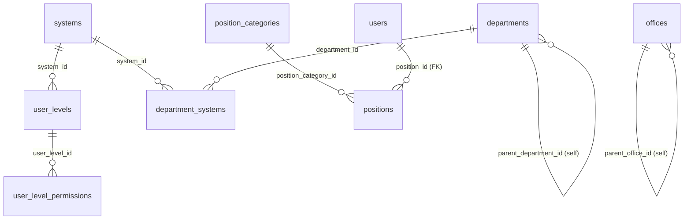
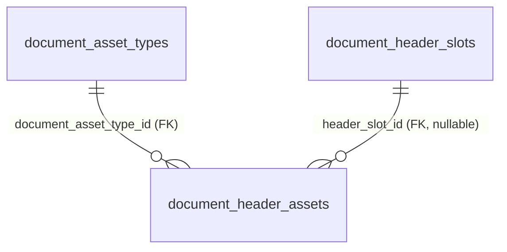
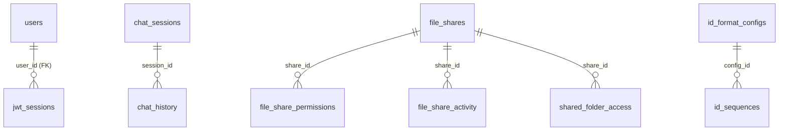
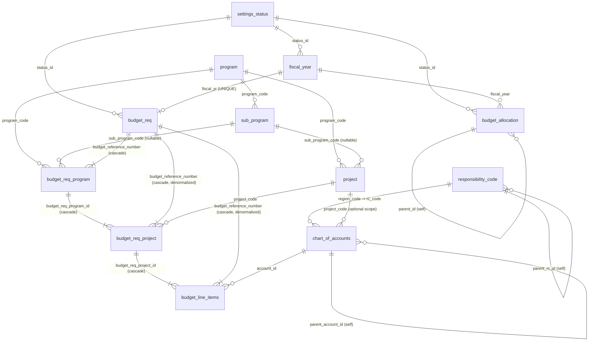
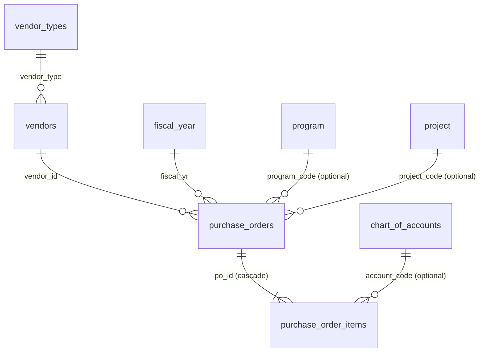

# Entity-Relationship Diagrams — FIMS NHA

> **Status:** rewritten 2026-11-09 against the actual schema in `_assets/sql/` and a verified
> dry-run install. The previous version of this file described a 9-schema, 371-file predecessor
> architecture (`shared`, `accounting`, `treasury`, `regional`, `district`, `integration`, an
> `ACCOUNTING-BAPD/sql/` tree, `npm run …` wrappers) that predates this repo's 2026-11-06 rebuild —
> none of that exists here. See `system_docs/developerguide/DEVELOPER-GUIDE.md` §11 for the full
> list of docs still carrying that old architecture, and `_assets/sql/README.md` for the SQL
> folder / installer mechanics (not duplicated here).

## Scope

Only **two schemas have tables in them today**: `uac` and `fims`. `schema.sql` also creates `fmd`
and `workflow`, but nothing is ever created inside them — leftovers from the predecessor project's
schema plan (see `_assets/sql/README.md` → Database Schemas).

| Schema | Tables (verified dry-run install) | Covered below |
|---|---|---|
| `uac` | 30 | §1 |
| `fims` | 20 | §2 |
| `fmd` | 0 (schema exists, empty) | — |
| `workflow` | 0 (schema exists, empty) | — |

## How to read these diagrams

Every relationship drawn below (`||--o{`, `||--|{`, `||--o|`) is backed by an actual
`FOREIGN KEY` / `REFERENCES` constraint in the SQL — **not** just a same-named column.

This distinction matters a lot in `uac`: most of its tables were generated by PHPMaker from the
predecessor project's conventions, and outside of four constraints (see §1), every other
`*_id` column that *looks* like a foreign key (`users.department_id`, `departments.office_id`,
`user_level_assignments.user_id`, `plantilla_items.position_id`, …) is a **plain, unenforced
integer** — no constraint exists in the database. Nothing stops an orphaned value. Those links are
called out in prose under each table, not drawn, so the diagrams don't claim integrity guarantees
the schema doesn't actually have. `fims`, built fresh for this rebuild, is the opposite: almost
every relationship is a real, enforced FK — the few exceptions are called out explicitly in §3.

---

## 1. `uac` schema — User Access Control & platform

### 1.1 Identity, organization & permissions

Only `users.position_id -> positions.position_id` is an enforced FK (added in
`02 - alter_table/03 - users_add_position_employee_mustchange.sql`). Everything else in this group
is a conventionally-named, **unenforced** link:

| Table | Purpose | Unenforced links (no DB constraint) |
|---|---|---|
| `systems` | Registry of subsystems (FIMS, …) a user level can be scoped to | — |
| `user_levels` | Named permission levels (e.g. "Department Manager"), optionally scoped to a `system_id` | `system_id` → `systems` |
| `user_level_permissions` | Bitmask (1=View, 2=Add, 4=Edit, 8=Delete) per `(user_level_id, table_name)` | `user_level_id` → `user_levels` |
| `user_level_assignments` | Which user has which level, per system | `user_id` → `users`, `user_level_id` → `user_levels`, `system_id` → `systems` |
| `users` | Login + identity. `user_level_id` is a **comma-separated VARCHAR** (PHPMaker convention), not an FK at all | `department_id` → `departments`, `reports_to_user_id` → `users` (self) |
| `departments` | Org hierarchy; `department_type`/`hierarchy_level` flag org level; `is_budget_unit` flags budget-holding units | `parent_department_id` (self), `office_id` → `offices`, `rc_id` → *intended* `fims.responsibility_code` (see gap in §3) |
| `department_systems` | Which department can access which system, with an `access_level` | `department_id` → `departments`, `system_id` → `systems` |
| `offices` | Physical NHA office locations | `parent_office_id` (self), `rc_id` → *intended* `fims.responsibility_code` (same gap) |
| `user_offices` | A user's office assignments (multi-office support), one flagged `is_primary` | `user_id` → `users`, `office_id` → `offices` |
| `position_categories` | Classification of positions (First/Second/Third Level, Elective, …) | — |
| `positions` | Position **templates** (e.g. "Administrative Assistant III") reusable across departments | `position_category_id` → `position_categories` |
| `plantilla_items` | Authorized staffing slots per department+position, with budget allocation fields | `department_id` → `departments`, `position_id` → `positions` |
| `permission_module_captions` | Admin-editable display caption / hide-flag for a module row in the Permissions Management UI — does not touch `user_level_permissions` itself | — |

### 1.2 Document branding (letterhead/footer composer)

Both relationships here **are** enforced FKs.

| Table | Purpose |
|---|---|
| `document_asset_types` | Kinds of branding asset (`HEADER`, `FOOTER`) and the px size each renders at |
| `document_header_slots` | The 4 managed parts of the NHA letterhead — `LOGO`, `TITLE` (text), `BRAND`, `SEAL` — their left-to-right order and default column width % |
| `document_header_assets` | Uploaded image (or, for `TITLE`, plain text) per slot/scope. `scope_system_code`/`scope_document_code` narrow an asset to one system or document type; `header_slot_id IS NULL` means a legacy whole-header image. A partial unique index enforces **one active asset per `(type, slot, scope)`** |

### 1.3 Collaboration & platform utilities

Only `jwt_sessions.user_id -> users.user_id` is enforced. The rest (`chat_history.session_id`,
every `file_share*.share_id`/`user_id`, `id_sequences.config_id`) are unenforced integer links.

| Table | Purpose |
|---|---|
| `jwt_sessions` | Server-side registry of every JWT issued (LIBIS login today) — enables revocation and tamper/discrepancy detection against the token's own claims |
| `chat_sessions` / `chat_history` | AI-assistant chat sessions and their messages, per user |
| `file_shares` / `file_share_permissions` / `file_share_activity` / `shared_folder_access` | S3-backed file sharing: the share itself, per-user permission level, an audit trail, and a "favorites" list |
| `id_format_configs` / `id_sequences` / `id_reset_strategies` | Configurable document-numbering formats (e.g. `PR-FY2025-0001`) and the running counters that back them |
| `notifications` | PHPMaker-compatible system notifications. **Marked "STRICT – DO NOT MODIFY"** in its own `COMMENT ON TABLE` |
| `audit_logs` | PHPMaker-compatible immutable audit trail (one row per changed field). **Also marked STRICT – DO NOT MODIFY.** `uac.aggregated_audit_logs` is a view that rolls these up one-row-per-save for the dashboard |
| `psgc` | Philippine Standard Geographic Code reference table (regions/provinces/cities) |

---

## 2. `fims` schema — Budgeting, Reference Data & Procurement

### 2.1 Budgeting & reference data

| Table | Purpose / notes |
|---|---|
| `settings_status` | Shared status lookup, scoped per entity via `status_for` (e.g. `'fiscal_year'`, `'budget_req'`). `actors` (JSONB) names who may act on a record in that status |
| `fiscal_year` | One row per fiscal year; PK is the year itself (`SMALLINT`) |
| `program` / `sub_program` / `project` | Budget hierarchy. A project optionally narrows to a `sub_program_code`; a sub-program always belongs to one `program_code` |
| `budget_req` | **One header row per fiscal year** (`UNIQUE(fiscal_yr)`, enforced in `03 - alter_table/04`). Despite the name, it no longer carries an amount, program, or expense class directly — see gap note in §3 |
| `budget_req_program` | One Program (optionally + Sub-Program) line added to a `budget_req` header |
| `budget_req_project` | One Project line, nested under a `budget_req_program` row (and, redundantly, under the `budget_req` header directly — see denormalization note below) |
| `budget_line_items` | One chart-of-accounts allocation under a `budget_req_project` row. Carries `proposed_amount`, `suggestion_amount`, and the execution-tracking amounts `adjustment` / `obligation` / `disbursement` / `account_payable` (all `NOT NULL DEFAULT 0`). `component_id` / `type_of_fund_id` are present but **have no FK** — see §3 |
| `budget_revision` | Moves an amount from one `budget_req` to another (or just revises one in place when `to_budget_req_id IS NULL`). **`from_budget_req_id`/`to_budget_req_id`/`status_id`/`user_id` are plain integers with no FK constraint at all**, despite the names — not drawn above |
| `chart_of_accounts` | COA tree (`parent_account_id` self-FK). Optionally scoped to a responsibility center (`region_code -> responsibility_code.rc_code`) and/or a `project_code` |
| `responsibility_code` | RCA (Responsibility Center/Accounting) tree (`parent_rc_id` self-FK). `is_budget_holding_rc` flags units that can hold a budget. `rc_id` is the PK and is `VARCHAR(10)` — see the `uac.departments`/`uac.offices` type-mismatch gap in §3 |
| `type_of_fund` / `component_type` | Small lookup tables (fund source; CO / Other-CO / COE) seeded with a handful of rows. Referenced by `budget_line_items.type_of_fund_id` / `.component_id` **by convention only — no FK exists yet** |
| `budget_allocation` | Memo/PR/PO allocation tracking per fiscal year + requesting department/district, with a `parent_id` self-FK for derived allocations. Built via `CREATE TABLE fims.budget_allocation(); ALTER TABLE ... ADD COLUMN` (see the file for why). Most of its columns (`requesting_department_id`, `requesting_district_id`, `program_id`, `sub_program_id`, `project_id`, `category_id`, `user_id`) are **deliberately left unconstrained** — see the comment in `03 - alter_table/08 - budget_allocation_add_fk.sql` for the reasoning per column |

**Denormalization, twice:** `budget_line_items` carries both `budget_req_project_id` (the real
parent) and `budget_reference_number` (the grandparent header), and `budget_req_project` carries
both `budget_req_program_id` (the real parent) and `budget_reference_number` (same grandparent).
Both are intentional — see the comments in `03 - alter_table/03` and `03 - alter_table/05` — so
existing header-level joins/counts keep working without walking the full chain. The service layer
keeps both columns in sync on write; nothing in the DB enforces that they agree.

### 2.2 Vendors & procurement

API: `app/routes/vendor.php`, `app/routes/purchase-order.php` (see `app/routes/README.md`).
Pages: `app/pages/po/{page,form,readone}.php`.

| Table | Purpose / notes |
|---|---|
| `vendor_types` | Valid vendor categories (`SUPPLIER`, `CONTRACTOR`, `CONSULTANT`, `SERVICE_PROVIDER`, `EMPLOYEE` — seeded). `vendor_type` is UNIQUE so `vendors` can FK to it by value |
| `vendors` | Suppliers/contractors/consultants. `vendor_code` is UNIQUE; `vendor_type` is a real FK (by value, not id) |
| `purchase_orders` | One PO. `po_number` UNIQUE (`PO-YYYY-MM-NNNN`). Vendor name/address/TIN are a **snapshot** copied from `vendors` on save, so later vendor edits don't rewrite history. `status`: `DRAFT → SUBMITTED → APPROVED / REJECTED`; `DRAFT`/`SUBMITTED`/`REJECTED` can be `CANCELLED`. `expense_class` here is a free-text column with its own `CHECK (... IN ('PS','MOOE','CAPITAL_OUTLAY','CO','OTHER'))` — **it is not the same vocabulary as, or linked to, `fims.expense_class`** (see §3) |
| `purchase_order_items` | Line items. `total_cost` is generated (`ROUND(quantity_ordered * unit_cost, 2)`); `(po_id, line_number)` is UNIQUE. `account_code` FKs to `chart_of_accounts.account_code` — the **only** FK in this schema that targets an alternate key instead of the primary key |

**Deliberately not ported** from the predecessor project's `fmd.purchase_orders`: parent purchase
request, budget allocation, fund source, fiscal period, workflow engine/payment workflow, and
delivery receipts — none of those tables exist in `fims`. Status changes are driven entirely by
`PurchaseOrderService::changeStatus()`, not a workflow engine.

---

## 3. Cross-schema links & known gaps

| From | To | Enforced? | Note |
|---|---|---|---|
| `uac.users.region_code` | `fims.responsibility_code.rc_code` | **Yes** (FK) | Scopes a user to one RCA code for Chart-of-Accounts row-level security; `NULL` = unrestricted. Superadmin (`user_level_id` containing `-1`) always bypasses it regardless |
| `uac.departments.rc_id` | `fims.responsibility_code.rc_id` | **No — can't be**: type mismatch | `departments.rc_id` is `int4`; `responsibility_code.rc_id` is `VARCHAR(10)`. The column exists ("Responsibility Center Code for financial tracking") but cannot physically FK to the table it's named after. Same issue on `uac.offices.rc_id` |
| `fims.expense_class` | *(nothing)* | — | Seeded with `CO`/`PS`/`MOOE`/`EO` but **no longer referenced by any FK** — `budget_req.expense_class_id` (its only consumer) was dropped in `03 - alter_table/02 - budget_req_remove_expense_class_flow.sql`. `purchase_orders.expense_class` is a separate, differently-valued free-text column, not a link to this table. Orphaned lookup table; confirm nothing reads it before dropping |
| `fims.budget_line_items.component_id` / `.type_of_fund_id` | `fims.component_type` / `fims.type_of_fund` | No | Named and seeded to match, but no FK constraint exists yet (see table comment in `03 - alter_table/06`) |
| `fims.budget_revision.from_budget_req_id` / `.to_budget_req_id` | `fims.budget_req.budget_reference_number` | No | Plain integers despite the name; nothing stops a dangling value |
| `fims.budget_allocation.{program,sub_program,project}_id` | `fims.{program,sub_program,project}` | No — can't be | Those tables are keyed by `*_code VARCHAR`, not an integer id; `budget_allocation` stores integers. Intentionally unconstrained per `03 - alter_table/08` |

None of the above are bugs to silently "fix" by adding a constraint — several are deliberate
(per the cited comments). Treat this table as a map of where the schema's actual guarantees stop,
not a to-do list.

---

## Related docs

- `_assets/sql/README.md` — SQL folder layout, installer mechanics (`install_system.js`), where to
  put a new table/alter/seed file. Not duplicated here.
- `system_docs/developerguide/DEVELOPER-GUIDE.md` — overall architecture, module inventory, and
  §11's list of other docs that still describe the predecessor project.
- `app/routes/README.md` — per-endpoint API reference for the routes built on top of these tables.
